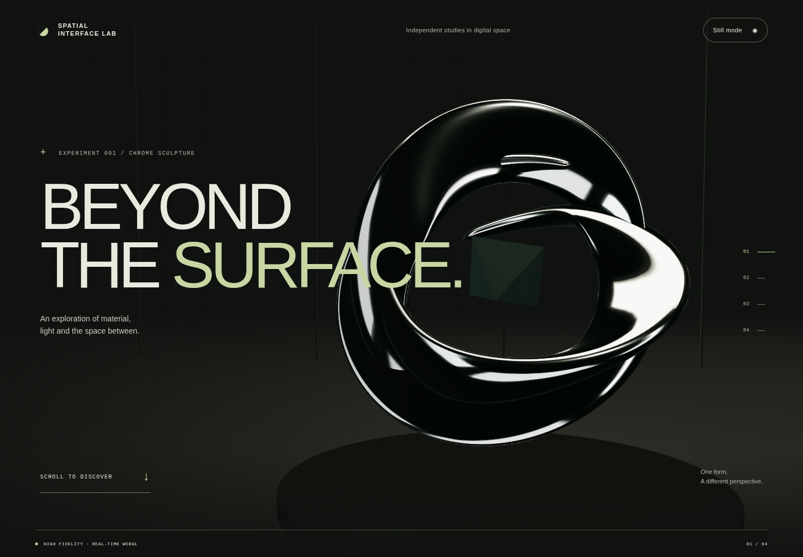

# BEYOND THE SURFACE

**Spatial Interface Lab / Experiment 001 — Chrome Sculpture**

An original interactive study of folded chrome, optical glass and spatial perception. A single procedural sculpture is explored through scroll-driven camera compositions, followed by a small keyboard-accessible material lab.

**Status: Draft PR open; Chromium verification passed, Vercel Preview blocked by workspace authorization.** [Repository](https://github.com/tupptupp/spatial-interface-lab) · [Draft PR #1](https://github.com/tupptupp/spatial-interface-lab/pull/1) · [Reviewed green CI checkpoint](https://github.com/tupptupp/spatial-interface-lab/actions/runs/38958637142).



_Actual Chromium/SwiftShader capture of source commit `2929571bce07af133a35c71cc745c8cc24f1d422`, 1440 × 1000. [Mobile](docs/screenshots/mobile-reveal.png) · [Material lab](docs/screenshots/desktop-lab.png). Original geometry comparisons are separately labeled offline studies in `docs/studies`._

## The experience

- A bounded 1.1-second exposure reveal introduces the sculpture.
- Native scrolling moves through three authored viewpoints and a final inspection shot; reverse scrolling derives exactly the same transforms.
- The material lab changes chrome roughness, sculpture rotation and the key-light angle. Native range inputs support keyboard and touch; reset restores all three values.
- Reduced motion, rendering failures and optional still mode use a compact static illustration with complete HTML content.
- The renderer allows one GPU frame in flight and sleeps when the latest pose and material state have completed. It resumes for user input, resize or visibility changes.

## Run locally

Node **22.18+** (tested with Node 24.19.0).

```sh
npm ci
npm run dev
```

Open the local URL printed by Vite. Serve the build; do not open `dist/index.html` directly.

```sh
npm run typecheck
npm run lint
npm run format:check
npm test
npm run build
npm run preview
```

For the prepared browser suite:

```sh
npx playwright install --with-deps chromium
npm run test:e2e
```

For actual screenshots and profiling evidence, start `npm run preview` on port 4173, then run `npm run evidence:capture`. `PREVIEW_URL` may point to an authorized preview. No authentication headers, tokens or secrets are required by the application.

## Architecture and trade-offs

| Layer             | Responsibility                                                                   |
| ----------------- | -------------------------------------------------------------------------------- |
| `src/app`         | Semantic document, rendering lifecycle, fallback, lab UI                         |
| `src/animation`   | Pure camera keyframes, easing, chapter-to-progress mapping                       |
| `src/scene`       | Original BufferGeometry, PBR materials, procedural environment, render loop      |
| `src/interaction` | Clamped control parameters and live motion preference subscription               |
| `src/performance` | Bounded quality configuration and downgrade hysteresis                           |
| `tests`           | Geometry, choreography, state, lifecycle, deployment guard and browser scenarios |

React + strict TypeScript + Vite, Three.js, React Three Fiber and selected Drei environment helpers. No backend, database, authentication, AI service, external model, font download or third-party texture. No GSAP or custom GLSL: the pure scroll mapping and built-in PBR materials meet the current requirements without those additions.

The optional scene is split from the HTML/UI bundle. It is still a large dependency payload (~973 kB minified, ~263 kB gzip in the recorded build); lazy loading avoids it in reduced-motion mode but does not eliminate its download cost for 3D visitors.

## Evidence and review

36 unit/integration/guard tests and eleven Chromium scenarios pass at the linked runtime checkpoint: startup, forward/reverse scroll, keyboard controls/reset, 320/390/768px layouts, reduced-motion behavior, renderer remount, real context-loss recovery, axe scans, keyboard skipping and noscript fallback. The strict evidence step also passed, including non-empty completed-draw samples.

Actual desktop/mobile captures were opened and reviewed. Hardware performance, physical touch devices, Safari, Firefox and actual GPU memory reclamation remain unverified. Automated axe passing is not full WCAG conformance. The software renderer produced only four workload samples (median completion latency 1593.9ms, p95 3442.1ms), so performance is not accepted. These are submission/fence completion upper bounds, not FPS. No Lighthouse claim is made.

See [verification](docs/verification.md), [performance](docs/performance.md), [rendering](docs/rendering.md), [architecture](docs/architecture.md), [design decisions](docs/design-decisions.md), [development](docs/development.md) and [engineering review](docs/review.md).

## Authorship and assets

The owner supplied the concept, brief, constraints and portfolio goals. Implementation, tests, documentation and the procedural illustration tool were AI-assisted. Verification claims describe only checks actually run. This is a portfolio study, not a claim of professional production experience.

Geometry, illustrations and page styling were created for this project. Dependencies retain their respective licenses. No commercial studio code, shaders, artwork, textures or fonts, and no private Formodo assets, are included. No outbound analytics or application data collection is implemented. A distribution license for the original project has not been selected by the owner.

## Release boundary

Development belongs on `feature/chrome-sculpture`. `main` contains only the minimal working foundation. Do not merge or promote to production without explicit owner approval. The feature build actively rejects `VERCEL_ENV=production`. The separate Vercel project exists, but GitHub linking and source upload were denied by integration/workspace authorization; [handoff](docs/handoff.md) describes them.
