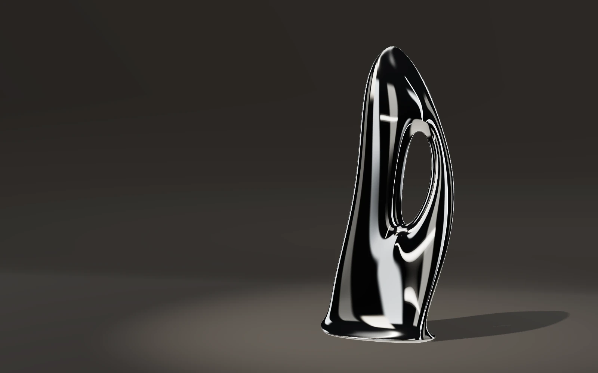
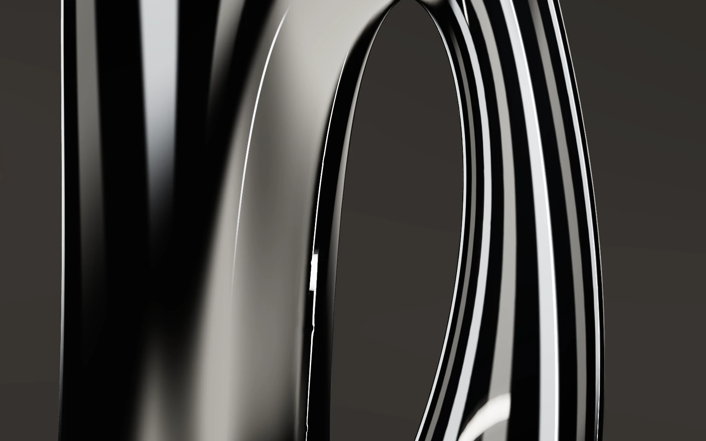
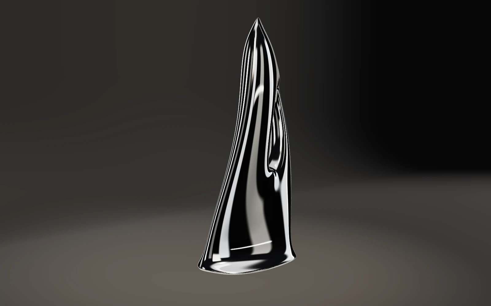
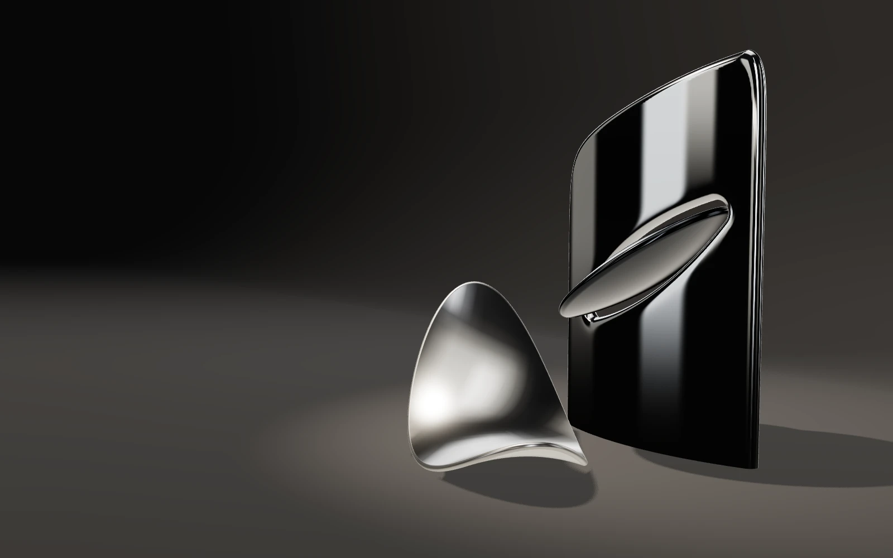
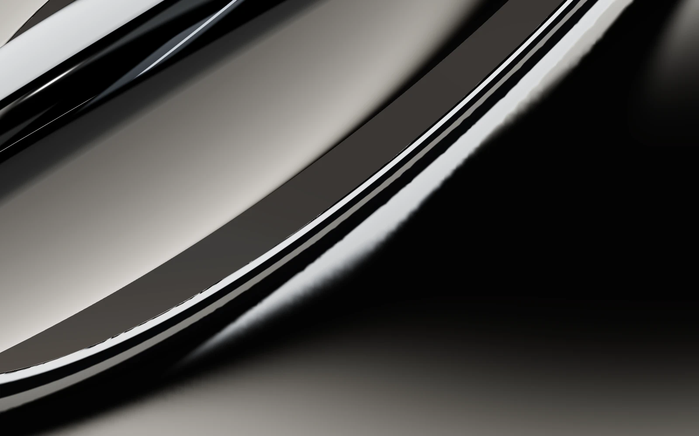
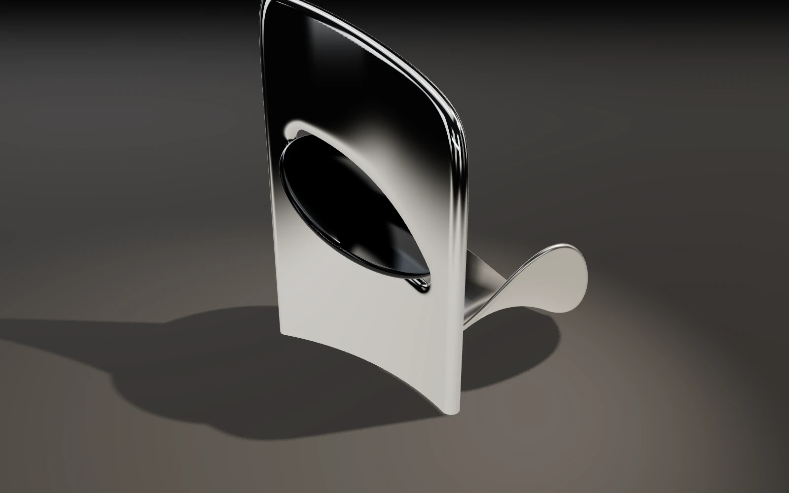
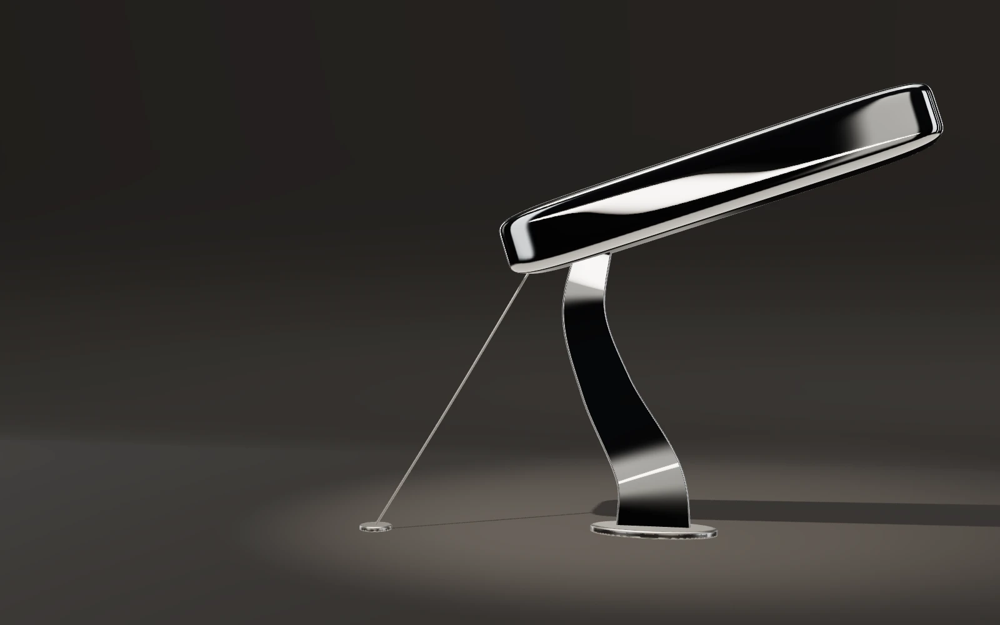
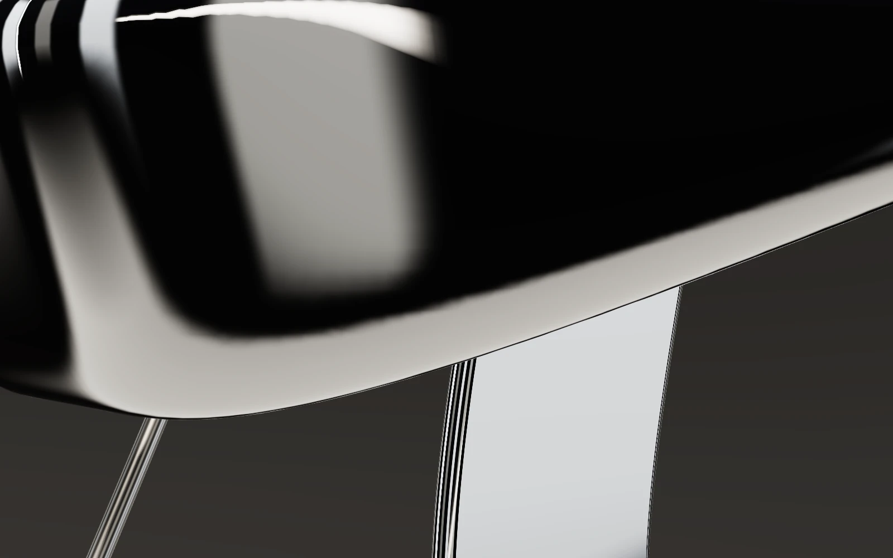
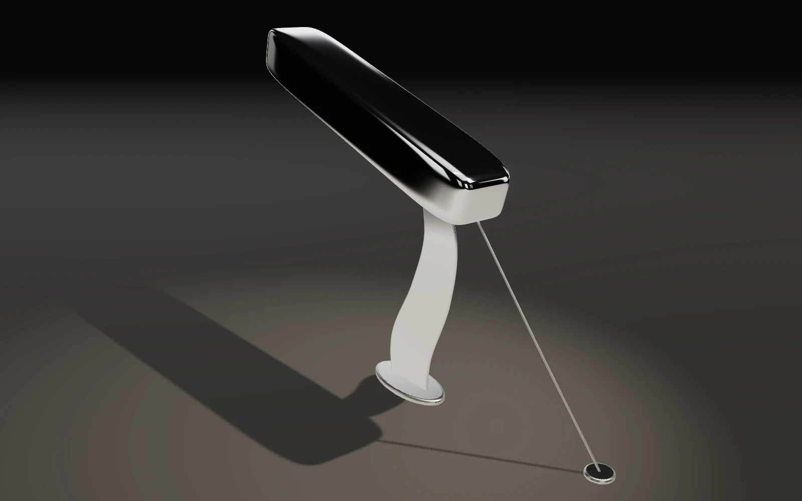

# Sculpture art direction — Phase 01 concept study

**Phase 02:** the owner selected Concept B. Its visual refinement, **B′ · Eclipse**, is in [refined/](refined/README.md). The frames below are the Phase 01 record, captured at `c251d48`.

**Branch:** `feature/sculpture-art-direction` (from `feature/chrome-sculpture` @ `8f8841c`). Development-only exploration. The production experience, its tests and its fallback are unchanged.

All frames below are real WebGL captures from `explore.html`, produced by `scripts/capture-concepts.mjs` in **headless Chromium 141 on SwiftShader (CPU, Vulkan/ANGLE)**, 1600 × 1000 at DPR 1 (mobile 390 × 844 at DPR 2). SwiftShader is a conformant rasterizer, so geometry, reflections and tone mapping are representative. It says nothing about GPU frame time, and real-GPU colour and precision were not inspected.

## 1. Audit of the existing sculpture

Observed in rendered frames ([reveal](existing-reveal.webp), [structure](existing-structure.webp)):

- **Silhouette:** three copies of the same tube read as gyroscope rings or a torus knot. It is the stock-parametric look the brief warns against.
- **Chrome:** most of the surface renders black. The environment is a near-black sphere with four small cards, so curvature only shows where a card happens to land.
- **Glass core:** on SwiftShader the octahedron renders as a flat green faceted gem. Transmission at 0.35–0.5 resolution gives no readable refraction.
- **Environment:** a generic dark floor and cylinder plinth, plus five thin vertical posts that read as stray lines. There is no lighting pool or cove, so depth is weak.
- **Camera:** the shots are orbital variations around one centre at similar distances and focal lengths. At 1600 × 1000 the chapter navigation overlaps the sculpture.

From the code (`src/scene`):

- The single blade is reused three times. The geometry is good engineering: closed, seam-welded and tested. The problem is the design.
- Cube faces are 256 px (128 px balanced), which is soft for mirror chrome at macro distances.
- A full transmission pass is spent on a visually weak glass element.
- `MeshStandardMaterial` at 1.2 env intensity is not the issue. The environment content is.

## 2. The studio (shared by all concepts)

- **Reflection environment:** baked once into a 512 px cube (256 px balanced) from emissive cards, using feathered textures so highlights fall off like diffusers.
  - A ring of eight tall softboxes with alternating strengths and black gaps.
  - An overhead scrim and a lit floor card.
  - Per-concept strip lights.
- **Why precomputed:** the subject is static during this phase, and a baked environment gives authored, repeatable highlights at zero per-frame cost. A real-time cube camera would add six scene renders per update for parallax that cannot be seen on convex forms.
- **Visible scene:** an infinity-cove cyclorama, so there is no floor/wall seam. A warm key spot provides the floor pool and the only shadow map (2048, PCF soft), plus a one-shot contact shadow.
- **Rendering:** ACES Filmic, exposure 1, sRGB output, MSAA, and no post-processing (no bloom, no chromatic aberration).
- **Materials:** physically motivated metals. Chrome is `#c9cbcc` at roughness 0.035, satin is roughness 0.22, smoked chrome is `#3d4043`.
- **Fair comparison:** a **Baseline studio** toggle applies an identical rig to all three concepts. The concept rigs only add or retune cards, and the UI flags them with an amber note.

Key lesson, from the [iteration log](#6-iteration-log): mirror chrome reflects the horizon band and the area behind the camera. Leaving those empty made every form look like black lacquer. Reference chrome spheres confirmed the material was correct and the room was the problem.

## 3. Concepts

|                           | Hero ≈50 mm                | Detail ≈90–100 mm            | Spatial ≈35 mm                |
| ------------------------- | -------------------------- | ---------------------------- | ----------------------------- |
| **A · Liquid Monolith**   |     |     |     |
| **B · Interlocked Forms** |  |  |  |
| **C · Tension Study**     |      |      |      |

Mobile heroes: [A](monolith-hero-mobile.webp) · [B](interlocked-hero-mobile.webp) · [C](tension-hero-mobile.webp). The same nine frames under the identical baseline rig use the `-baseline` suffix. The comparison UI is shown in [desktop](explore-ui.webp) and [mobile](explore-ui-mobile.webp) captures.

### A · Liquid Monolith

- **Intention:** a single poured blade in a contrapposto S-curve, turning about 60° as it rises. The crown slumps; an offset void leaves one slender strand; the base settles into a shallow meniscus.
- **Geometry:** one implicit surface built from a warped ellipsoid column, a smooth-subtracted void and a meniscus, all combined with exponential (C∞) blends. It is polygonised by surface nets, then every vertex is Newton-projected onto the zero set, with analytic gradient normals. The mesh is a closed manifold (welded, tested).
- **Light:** the panel ring draws vertical bands that travel along the twist. The concept rig adds two vertical strips and a low front line.
- **Compositions:**
  - Hero: three-quarter, low eye line, subject on the right third.
  - Detail: the void lip.
  - Spatial: low, from the left, where the twist reads as an edge.
- **Limitations:**
  - A small pinch where the lower void lip meets the twist.
  - The form risks a generic "organic chrome totem" reading; it is the least original of the three.
  - The spatial view shows a near-knife crown silhouette.
- **Cost:** 105k triangles at high (33k balanced), 1 draw call. **Geometry build ≈3.5 s on the main thread at high** (≈0.9 s balanced, measured in Node). That cost is unacceptable for production; bake it or move it to a worker.

### B · Interlocked Forms

- **Intention:** three authored bodies in three thicknesses and three finishes.
  - A curved chrome stele, 140 mm-equivalent thick.
  - A heavy smoked-chrome biconvex lens threaded obliquely through a window in the stele.
  - A thin satin hyperbolic-paraboloid leaf, 48 mm-equivalent.
- **Assembly:** the window is the lens's exact distance field offset by a 50 mm-equivalent gap, so the clearance is uniform by construction. Tests check the clearance, and check that the stele remains a single connected body.
- **Geometry:**
  - Stele: SDF surface nets, continuing below the floor plane so the depth buffer draws the contact line.
  - Lens: an exact lathe of an analytic vesica profile with a true round rim.
  - Leaf: an analytic thick plate, the mid-surface offset by ±t with a half-round rim. It is placed by computation so its lowest point rests exactly on the floor.
- **Light:** the concept rig adds a graded card exactly on the stele's hero reflection path, plus a back rim strip.
- **Compositions:**
  - Hero: oblique three-quarter, so the disc reads as threaded rather than as a slot. It layers foreground leaf, mid lens and back stele.
  - Detail: the window lip, gap and lens rim.
  - Spatial: high, from behind.
- **Limitations:**
  - The leaf can read as a "chip".
  - A frontal view reduces the lens to a slit, because a disc through a wall is edge-on from the front. Camera choreography has to respect that.
  - The window lip at macro is the softest edge in the set.
- **Cost:** 305k triangles at high (90k balanced), 3 draw calls; 2.6 s build at high. The stele resolution should be tuned before production.

### C · Tension Study

- **Intention:** a long polished billet cantilevered on one bow blade placed left of its centre of mass, and pinned by a single hairline tie. Compression, tension and bending are all legible, and the physics is consistent: the tie really is in tension.
- **Geometry:**
  - Billet: a superellipsoid (exponent 7) via surface nets.
  - Blade and tie: analytic stadium-section sweeps along centripetal Catmull-Rom curves, with exact half-round edges for line highlights.
  - Seats: SDF pucks.
- **Light:** an edge-light rig with an overhead strip and side strips aimed at the thin edges.
- **Compositions:**
  - Hero: low, with the diagonal reaching across the frame.
  - Detail: looking up at the blade, tie and billet junction.
  - Spatial: from behind, high.
- **Limitations:**
  - The billet reads as a manufactured product (a lamp arm or bar), not as sculpture.
  - The hero leaves a large empty field.
  - Least depth layering of the three.
- **Cost:** 85k triangles at high (37k balanced), 4 draw calls; 1.1 s build. The cheapest concept.

## 4. Recommendation

**B · Interlocked Forms.** It is the most original and least figurative of the three, and the only one with real layered depth and three distinct material responses. That is a direct expression of "Beyond the surface". Its detail frame shows engineered precision rather than just reflections, and its parts give later motion something meaningful to do: the lens can rotate in its window, and the leaf can rock.

Trade-offs:

- **A** has the most continuous liquid highlights, but a weaker, more generic silhouette and the heaviest build cost.
- **C** has the clearest idea and the lowest cost, but reads as product design.
- If B is chosen, C's hairline tie is a candidate secondary element, and the B geometry should be baked offline or in a worker.

Honest standard check: B is clearly better than the prototype in silhouette, material and composition. These are strong still renders. They are not yet at the level of a top studio. That gap needs:

- Real-GPU review.
- Ambient occlusion or a reflective floor treatment.
- Typography integration.
- Measured motion.
- Possibly offline refinement of the leaf curvature.

## 5. Inspect locally

```sh
npm ci
npm run dev
# open http://127.0.0.1:5173/explore.html
#   ?concept=monolith|interlocked|tension &view=hero|detail|spatial
#   &rig=concept|baseline &fidelity=high|balanced &ui=0 (clean frame) &env=1 (show reflection environment)
# Re-capture (needs a Chromium; CHROMIUM_PATH optional):
node scripts/capture-concepts.mjs          # concept rig, 9 frames + 3 mobile
RIG=baseline SKIP_MOBILE=1 node scripts/capture-concepts.mjs
```

Keyboard: `1 2 3` concept, `H D S` view, `L` lighting, `R` reset; drag to orbit.

`explore.html` is not a Vite build input, so it never ships in `dist`. The production bundle size was unchanged in this phase.

## 6. Iteration log

1. **First render:** the chrome was almost entirely black, and A read as a thumb with a ring.
2. **Material check:** reference spheres showed the material and environment were correct. The horizon band and the area behind the camera were empty, so I added the panel ring and floor and overhead scrims.
3. **Unit tests caught two mesher defects:**
   - The sweep winding was inverted, so thin parts rendered inside-out.
   - Projection collapsed surface-net vertices, which left degenerate faces and holes.
   - Fixed with sign-based winding and vertex welding; both are now covered by closed-manifold tests.
4. **B's lens severed the stele.** The upper piece floated, which is physically impossible. The lens became smaller than the stele, and a connectivity test now guards it.
5. **A horizontal crease across the stele.** The two-sphere lens field is not a Euclidean distance outside its rim. I replaced it with an exact vesica, and a test checks it is 1-Lipschitz.
6. **Staircase silhouettes:**
   - On the thin leaf rim: replaced by an analytic thick plate.
   - On A's crown: fixed by thickening it.
   - On floor contact lines: the parts now continue below the floor.
7. **Composition:** the heroes moved to rule-of-thirds frames, and portrait frames re-centre on the subject. C's hero subject was moved because the overhang was cropped on mobile.
