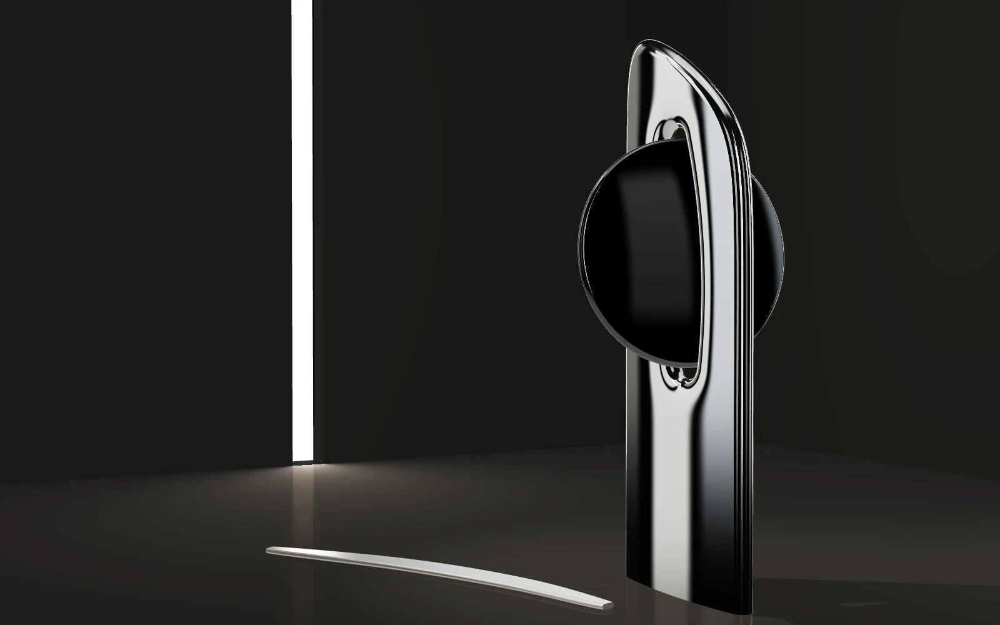
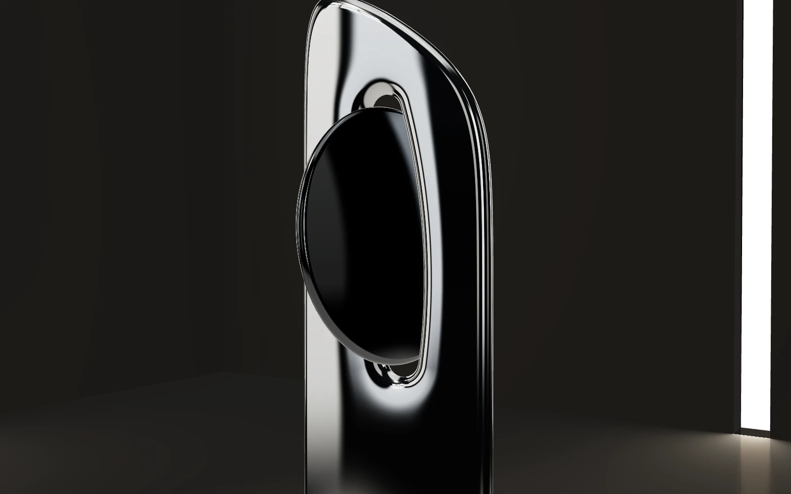
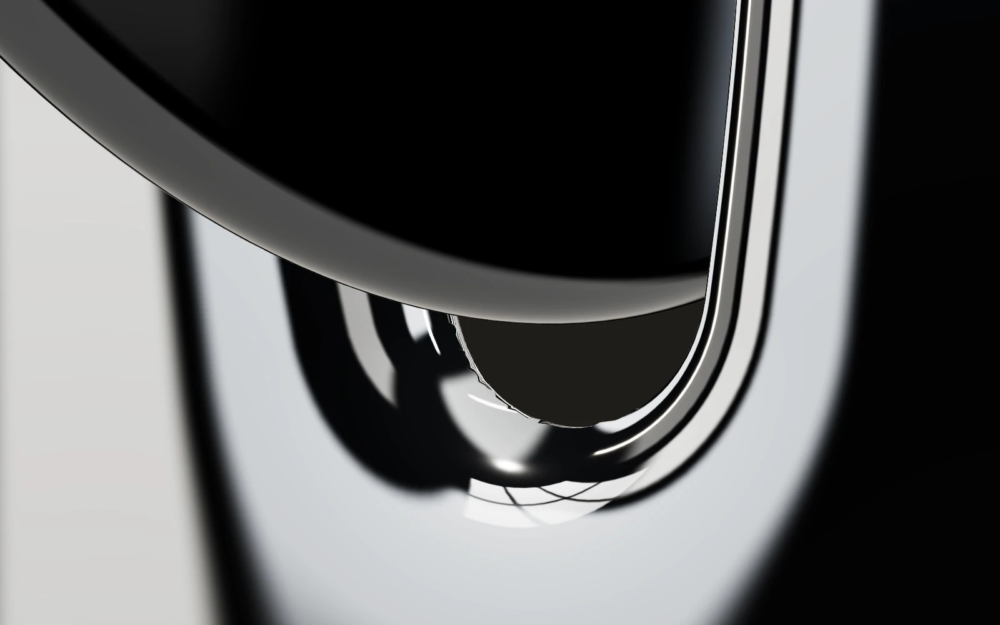
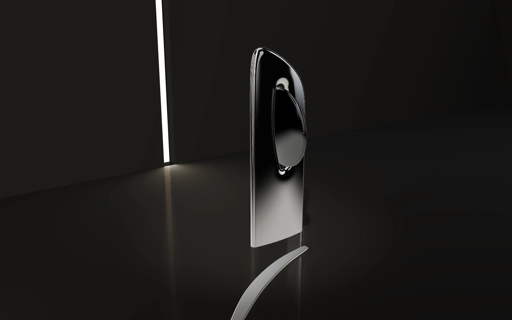

# B′ · Interlocked Forms — Refined ("Eclipse")

Phase 02 visual refinement of the owner-selected Concept B. This is a development-only study (`explore.html?concept=refined`). The original A, B and C stay unchanged in the comparison UI, and their Phase 01 frames in [`docs/concepts`](../README.md) remain as captured at `c251d48`.

All frames are real WebGL captures: headless Chromium 141, SwiftShader (CPU), 1600 × 1000 at DPR 1, and 390 × 844 at DPR 2 for mobile. The frames are representative of geometry, reflections and tone mapping. They say nothing about GPU frame time or real-device colour.

| Hero ≈50 mm              | Alternative hero ≈40 mm (worm's-eye) |
| ------------------------ | ------------------------------------ |
|    |                 |
| **Detail ≈90 mm**        | **Spatial ≈35 mm**                   |
|  |             |

Mobile hero: [refined-hero-mobile.webp](refined-hero-mobile.webp). Same hero under the shared baseline lighting: [refined-hero-baseline.webp](refined-hero-baseline.webp).

## What changed from B, and why

- **Silhouette.**
  - B's wide slab with a letterbox window became a slim stele (1.24 wide, 3.65 tall) with a concave crown.
  - The disc now stands almost perpendicular to the stele and passes through a narrow vertical slot. Obliquely, it reads as a near-full circle crossing the pillar.
  - The composition reduces to vertical, circle and horizon.
- **Relationship.**
  - The slot is still the disc's exact distance field plus a 45 mm-equivalent clearance, so the gap is uniform by construction.
  - It now sits fully inside the stele, which therefore stays one body.
  - The saddle leaf read as a crisp, and then as a smile under a round "eye". It was replaced by a thin satin ground line lying flat on the floor, the horizontal counterpoint that leads the eye to the base.
- **Space.** The cyclorama gave way to a dark gallery:
  - A polished floor, using drei's `MeshReflectorMaterial` (blurred, low mix).
  - A back wall and a left wall, each with a full-height light slot that is a real `RectAreaLight`.
  - A far right wall.
  - The side slot sits in the hero's left third. The back slot rims the alt view.
- **Reflections and material.**
  - Every visible light source also exists as a card in the baked reflection cube, so reflections agree with the room.
  - A graded card sits exactly on the stele face's hero reflection path. That path is the view ray mirrored about the face normal, measured from the cube's capture origin.
  - A mullioned window card puts architecture, not just softboxes, into the chrome.
  - B′ has its own finishes: cool chrome at roughness 0.045, and a smoked disc with F0 ≈ 0.1 so it carries reflections instead of reading as black plastic.

## Defects found and fixed during refinement

1. **Mirror-like first attempt.** The disc sat at the stele's edge and read as an attached hand mirror. Moved inside the stele.
2. **Unwanted figure.** The round disc above a crescent leaf read as a face. The leaf was redesigned.
3. **Edge-on almond.** In the frontal view the thick biconvex disc became a vertical almond that read as an eye. I thinned the disc and replaced that frontal alternative with the worm's-eye frame.
4. **Camera behind a wall.**
   - The right wall stood behind the original right-side hero camera.
   - Portrait framing dollied the camera outside the room entirely.
   - Moving the wall out fixed both.
5. **Off-target reflection card.** It was placed relative to the sculpture rather than to the cube-capture origin, so it missed the reflection path. Corrected.
6. **Jagged slot lips in macro:**
   - Diagnosis, step by step:
     - Mesh normal-consistency checks were clean.
     - The artifact ignored shadow-map size and self-shadowing.
     - It scaled with the reflection-cube resolution.
   - So it came from cube-map texels of hard-edged cards, magnified by the concave fillet.
   - Fixed with anti-aliased mullion and strip edges, a wider slot fillet, a finer stele lattice and slightly higher chrome micro-roughness.
   - Two studio-wide changes came out of this: softer strip edges, and sculpture parts no longer receiving shadows. Both now apply to A, B and C as well.

## Known limitations

- **Balanced fidelity:** the slot silhouette is still slightly polygonal in macro, because of the coarser lattice and the 256 px environment.
- **Off-axis frames:** the stele's broad face reads darker in frames that don't hit the placed reflection card. Camera choreography should respect this.
- **Build cost:** 369k triangles and a 2.7 s main-thread geometry build at high fidelity (74k triangles, 0.4 s balanced, measured in Node). Most of it is the stele's 440-cell lattice. It must be baked at build time or moved to a worker before production.
- **Reflector floor:** adds a second scene render per frame.
- **Not verified:** real-GPU performance, Safari and Firefox.
